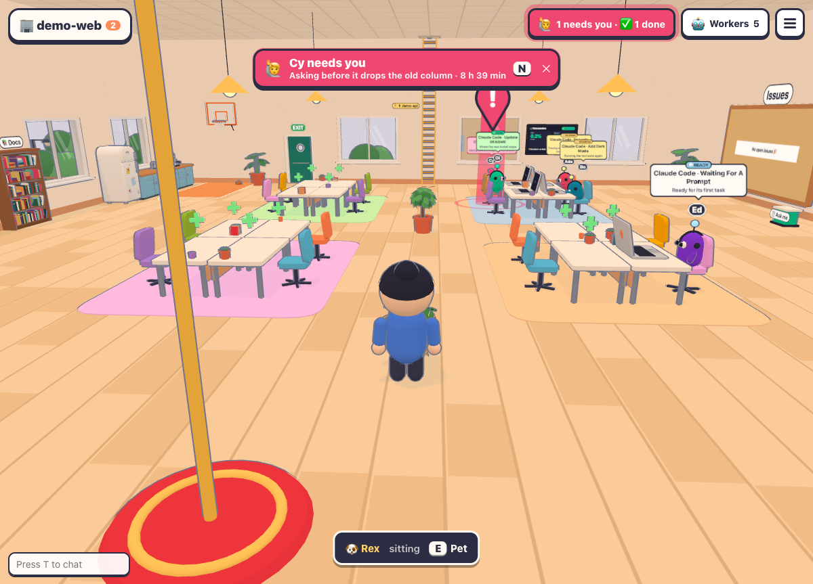

# orca-office

A 3D cartoon office on top of [Orca](https://orca.dev): every worktree is a desk, every agent session a figure, and you can see at a glance who is working, who needs you and who is done.

Status: M1. The 3D office runs against a stub bridge with made-up data ([docs/stub-protocol.md](docs/stub-protocol.md)); real Orca data comes in M2. See [docs/design.md](docs/design.md) and the milestone epics in Issues.



The 3D client is derived from [AgentSystemLabs/agent-office](https://github.com/AgentSystemLabs/agent-office) (MIT); [NOTICE](NOTICE) says what was taken from which commit.

## Layout

| Folder    | What                                                                 |
|-----------|----------------------------------------------------------------------|
| `shared/` | Wire protocol and helpers used by the bridge, client and plugin      |
| `bridge/` | Local Node process on `127.0.0.1` between Orca and the browser       |
| `client/` | 3D office in the browser (Vite + three.js), and the live list at `/live.html` |
| `plugin/` | Orca `trusted-worker` plugin; loaded by Orca as is, not an npm workspace |

## Develop

Node 24 (`.nvmrc`).

```sh
npm install
npm run typecheck && npm run lint && npm test && npm run build
npm run dev          # stub bridge + Vite: the 3D office at http://127.0.0.1:5317
npm run dev:live     # real bridge + Vite: your Orca agents in the 3D office (needs the plugin, see plugin/README.md)
npm run dev:fake     # real bridge on a made-up Orca (fake CLI + fake plugin, bridge/fake/): for demos and screenshots
npm run dev:bridge   # the real bridge, fed by the Orca plugin: http://127.0.0.1:4317/health
npm run dev:client   # Vite only; the live list is at http://127.0.0.1:5317/live.html
npm run typecheck:plugin   # needs `orca plugin types plugin` first (see plugin/README.md)
```

Running the bridge for good (macOS): `scripts/install-bridge.sh` installs it as a launchd agent
(`com.orca-office.bridge`: starts at login, restarts if it dies, outlives Orca restarts; logs in
`~/Library/Logs/orca-office/bridge.log`), `scripts/uninstall-bridge.sh` removes it. It runs from this
checkout and takes the same `ORCA_OFFICE_PORT` / `ORCA_OFFICE_CLIENT_PORT`.

Other ports: `ORCA_OFFICE_PORT=4417 ORCA_OFFICE_CLIENT_PORT=5417 npm run dev` (the bridge only lets
the page on `ORCA_OFFICE_CLIENT_PORT` in, and the page is built against `ORCA_OFFICE_PORT`).
