# Stub bridge protocol (M1)

`npm run dev` starts the bridge in stub mode (`ORCA_OFFICE_STUB=1`, `npm run dev:stub`) next to Vite.
In stub mode the bridge plays the office server for the 3D client with made-up data
(`bridge/src/stub.ts`), so the office boots without Orca. The plugin side (`/plugin`, HMAC
handshake) is unchanged; nothing the plugin sends reaches a stub page.

The wire format is agent-office's: one JSON object per WebSocket frame, typed by
`ServerMsg` / `ClientMsg` in `shared/src/office/protocol.ts`. The page connects to
`ws://127.0.0.1:<ORCA_OFFICE_PORT>/client` (default 4317); `/client` accepts only the office
page's origin, `http://127.0.0.1:<ORCA_OFFICE_CLIENT_PORT>` or `localhost` (default 5317).
Since M3 the socket must also present the page's token (`bridge/src/client-auth.ts`): the page
fetches it from its own server at `/__orca-office/token` (Vite hands it only to a same-origin fetch,
`client/vite-token.ts`) and asks for the subprotocols `orca-office` and `token.<hex>`; without it the
upgrade gets 401. The token lives in `~/.orca-office/client-token` (0600), apart from the plugin's key.
It keeps out browsers (other sites, other local ports, frames); a program on this machine can forge
the headers the token endpoint checks, so it is not a defence against local programs or accounts.

| Variable | Default | What |
|----------|---------|------|
| `ORCA_OFFICE_PORT` | 4317 | Bridge port; the client is built against it. |
| `ORCA_OFFICE_CLIENT_PORT` | 5317 | Vite port (`strictPort`), the only origin `/client` accepts. |
| `ORCA_OFFICE_STUB` | unset | `1`: stub mode. |

## Data

Two floors, `demo-web` (`stub-web`) and `demo-api` (`stub-api`), plus the roof. Workers, all
`kind: 'agent'`, provider `claude`:

| Floor | Desk | Worker | Status | Action cycle |
|-------|------|--------|--------|--------------|
| demo-web | desk-1 | Ada | working | read → edit → test |
| demo-web | desk-2 | Bo | working | test → failing → edit |
| demo-web | desk-3 | Cy | needs_input | |
| demo-web | desk-4 | Di | done | |
| demo-web | desk-6 | Ed | idle | |
| demo-api | desk-1 | Fa | working | read → web → edit |
| demo-api | desk-2 | Gu | needs_input | |
| demo-api | desk-5 | Ha | done | |

Each floor has its dog (Rex, a corgi, sitting). Issues, pull requests, pictures, services, the
cabinet's high scores and the jail are empty.

## Server → page (implemented)

| Message | When |
|---------|------|
| `welcome` | On connect. The whole building (`floors`, `projectsDir`, `version: 'stub'`, `me: { admin: true }`, sky, theme `off`, map `office`, empty chat, usage, limits, prompts, notify, machine) and the page's floor (`FloorView`). `peers` holds only the page itself, back where it stood if the query names the floor and a spot (`floor`, `x`, `y`, `z`, `rotY`), else in the elevator car. |
| `floor.enter` | Answer to `floor.go` for a stub floor or the roof (`@roof`: no workers, no dog). |
| `pong` | Answer to `ping`, with the bridge's clock in `now`. |
| `peer.update` | Answer to `profile` (name, color, look). |
| `worker.update` | Every 4 s, for each working worker on the page's floor: its next `action` (and `activity`), which the worker acts out. |

## Page → server (handled)

| Message | What the stub does |
|---------|--------------------|
| `ping` | Answers `pong`. |
| `move` | Remembers where the page stands. |
| `floor.go` | Moves the page to that floor or the roof and answers `floor.enter`; unknown floors are ignored. |
| `sit` | Remembers the seat (cleared on `floor.go`). |
| `profile` | Answers `peer.update`. |

Every other `ClientMsg` is ignored, and every other `ServerMsg` is never sent: no terminals
(`screen`, `term.*`), no hiring or sending home, no GitHub (`gh.*`, the PR and issue windows show
an error), no chat broadcast, decor, dog, ball, cabinet, gong, darts, sky, theme or map changes.
The page's HTTP calls to agent-office's `/api/*` (search, model lists, docs, terminal drops,
GitHub details) are not served either: Vite answers them with its own 404 or index page.

What replaces the stub: M2 (#13) feeds the same messages from Orca's workspaces and
agents; M3 adds terminals and actions.

## Live mode (M2)

Without `ORCA_OFFICE_STUB`, `/client` gets the same messages from Orca (`bridge/src/live/`):

| Source | What it gives the office |
|--------|--------------------------|
| Plugin snapshot (`workspace.list`, every 10 s and on connect) | Floors (Orca projects) and desks (open worktrees, with a sign over the desk; an open worktree without agents is an empty desk). |
| `orca agent list --json` (every 5 s, and ~0.3 s after an event names an unknown agent) | Figures: one per agent session (terminal or chat), its state and its last message cut to a 120-char bubble (`toBubble`), never stored or logged. |
| `orca agent list --json --environment <name>` for each paired environment `hostScope` names | Remote agents on their repo's floor, tagged `🌐 <environment>`. |
| `orca bot list --json` (every 15 s) and the bots' chat agents | The Staff floor: one desk per bot, nameplate, `idle` / `working` / needs you. |
| Plugin `agent.status.changed` | State at once (de-duplicated; done after a 1 s debounce); an agent not listed yet sits down at once. |
| Plugin `agent.tool.after` (`action`, `failed` worked out in the worker) | `action` / `activity` on working terminal agents: read, edit, test, web, failing after 2 failed runs in a row. |

Mapping: floor = repository, desk = worktree (1–4 seats side by side in one cluster, `+N` on the sign past 4), figure = agent session. Messages: `welcome`, `floor.enter`, `floors`, `plan` (desk signs), `worker.update`, `worker.remove`, and `{ t: 'orca', online }` (the page shows "Orca offline" while the plugin isn't connected). The 2D list (`live.html`) connects with `?list=1` and still gets the plugin's messages, redacted.

## Light control (M3)

On the live bridge the page can act on Orca (`bridge/src/live/actions.ts`, design #14). Typing goes through the CLI: on Orca 1.4.272 the plugin's `terminal.sendText` is refused for any
terminal outside the workspace active in Orca ("terminal is outside the active worktree"). Orca's
read leaves out what sits in an agent's input box until it is sent, so the terminal window shows
what you typed since the last Enter under it. Every other call
the bridge makes goes through the plugin's allowlist with exact param shapes
(`plugin/src/worker.ts` `validParams`); `orca worktree set` runs as the CLI.

| Page → bridge | What Orca does | Answer |
|---------------|----------------|--------|
| `worker.attach` / `worker.detach` (terminal agent on this machine) | `terminal.read` (500 lines) every 250 ms while the page has it open | `term.snapshot` with `cols: 0` when the text changed |
| `term.input` (only into the open terminal) | `orca terminal send --terminal <id> --text=<raw>`, in order, keystrokes merged while a send runs, ≤4096 chars a send | `orca.result` on errors |
| `worker.prompt` | `orca terminal send … --text=<prompt> --enter` (Orca submits it as a prompt) | `orca.result` on errors |
| `orca.open` | `workspace.open`, then `terminal.focus` for a terminal agent | `orca.result` |
| `orca.read` | `orca worktree set --worktree <id> --read` | `orca.result` |
| `orca.comment` / `orca.desk` | `orca worktree set --comment=<text>` / `orca worktree show` | `orca.result` / `orca.desk` |
| `orca.create` | `workspace.create` with `projectId`, `agent`, `prompt` (and `name`) | `orca.create`: creating → created → ready (the figure sat down) or failed |

Figures carry `orca: { terminal, remote }`; floors with an Orca project on this machine
`orcaCreate: true`. Agents on other hosts are shown but not acted on. Rate limits per page
(`bridge/src/rate.ts`): typing 200 frames / 64 KiB burst, new tasks 3 then one a minute, other
actions 20 then 2 a second. Terminal text, typing, prompts and comments are never logged or kept.

In the office (Orca mode) the desk keys are: E terminal (a chat agent: its last message; an empty
desk: new task), P prompt, O open in Orca, R mark read, C comment. `npm run dev:fake` fakes all of
it with made-up data (`bridge/fake/`).

Subagents (#17): the worker forwards `agent.tool.before` only for Claude Code's `Task`/`Agent` tool
(name and call id, nothing of the input) and returns at once, deciding nothing; the matching
`agent.tool.after` (same `callId`) ends it. Figures carry `helpers: n`, shown as up to 4 small
helpers around them and "+N" past that; they go when the parent's turn ends or after 30 min.
Seats: 1–4 per desk in one cluster and "+N" on its sign past 4 were already in M2.

Chat agents (no terminal) open a read-only conversation panel: `orca.chat.open` / `orca.chat.close`.
While it is open the bridge runs `orca agent read <orcaSessionId> --json --limit 50` every 4 s
(only for that panel, local agents only) and sends `orca.chat` (`state` of the latest turn, the
messages with role and text, tool names) when it changed. Real shape, checked on one chat:
`result.{state, limited, entries[{kind: 'message', role, text} | {kind: 'tool', name, state, shortened?}]}`.
The page renders the text as sanitized markdown without pictures or media (nothing is fetched).
The text goes only to that panel over the authenticated `/client`: never logged, stored or put
in tests or screenshots (those use `npm run dev:fake`'s made-up chat). Writing to a regular chat is
not possible (Orca has no API); bots take messages since M5 (below).

## Projects and navigation (M4)

Elevator (#31): every stop wears two badges, 🙋 *needs you* (figures waiting on you) and 👷 *working*,
from `FloorInfo.waiting` / `busy`; a quiet stop shows its seat count. Top to bottom: project rooms on
the roof (`room: 'project'`, the one needing you most first), the bots' Staff floor (`room: 'staff'`),
then the repositories' floors (numbered from the bottom), then the garage. Clicking a stop rides there.
The elevator's hint says how many need you on other floors. On Orca the panel neither clones projects
nor takes floors off: Orca's projects are the floors.
## Desk links (M4, #32)

`orca worktree list --json` (this machine, every 30 s and ~1.5 s after a `workspace.*` event, at most
every 5 s; ~0.17 s a call) says what Orca links to each worktree: `linkedItems[]` (`provider`, `type`
`pr`/`issue`, `number`, `url`, `title`) and the older single fields (`linkedPR`, `linkedIssue`,
`linkedGitLabMR`, `linkedGitLabIssue`, `linkedLinearIssue` + `linkedLinearIssueOrganizationUrlKey`,
`linkedWorkItem`, …). Real shape checked on Orca 1.4.272; some items come without a `url`, and the
bridge then derives it from another url of the same repository. The office never calls `gh`/`glab`.

| Bridge → page | What |
|---------------|------|
| `orca.links` | `{ floor, desks: { [seatId]: OrcaLink[] } }` on arriving and on change; every seat of a desk carries its links. |
| `plan` | The desk sign gets `pins` ("🔀 #12 · 📌 #34 +1"), drawn as a sticky strip under the name. |
| `gh.pulls` / `gh.issues` | The floor's wall boards: the linked PRs/MRs and issues (number, url, title), nothing else. |

`OrcaLink`: `provider`, `kind` (`pr`/`mr`/`issue`/`item`), `ref` ("#12", "!7", "ENG-42"), `url` (https
only), `title` (cut to 60 chars with `toBubble`, design #20). At a desk, **L** lists its links; E at a
wall board lists the floor's; each opens in the browser. On Orca the PR and issue windows inherited from
agent-office (which called its `/api/gh/*`) are never opened: a card or palette entry opens its url.

## Repo board (v2, #38)

Each repository floor's wall boards show the repository's open issues and pull/merge requests, read
through a `ForgeAdapter` (`bridge/src/live/forge.ts`): `gh` for github.com and `glab` for gitlab.com.
Self-hosted forges only when named in `ORCA_OFFICE_FORGE_HOSTS` (`github:ghe.example.com,gitlab:gitlab.example.com`):
a remote on any other host gets no CLI call, so a look-alike host never receives a token the CLI would send. The middle whiteboard is the
**queue**: open items no worktree works on yet, i.e. not linked to any of the repository's worktrees in
Orca (`linkedItems` and the older fields) and, for a pull/merge request, no worktree on its source branch.

- The repository is the floor's: one of its local worktrees (from the plugin snapshot and `orca worktree
  list --json`, matched by path and `repoId`), whose `git -C <dir> remote get-url origin` names the forge
  (`parseRemote`). No GitHub/GitLab remote: the board says so and no forge CLI runs.
- Calls, read only, through `execFile` with an argument array (never a shell), 15 s timeout, no prompts:
  `gh issue list -R <host>/<owner>/<name> --state open --limit 30 --json number,title,url`,
  `gh pr list … --json number,title,url,headRefName,isDraft`, `glab issue list -R https://<host>/<path>
  --per-page 30 --output json`, `glab mr list …`.
- Read only for a floor a page is on, at most one read per floor at a time; kept **in memory** for 3 min
  (after a failure: retried after 1 min, the last good lists stay up). Titles are cut to 60 with `toBubble`.
  Nothing is written to disk or logged.
- Tokens stay with the CLIs: the bridge never reads or passes one. A failure is told by kind only:
  `missing` (CLI not installed), `auth` (stderr hints at a login; the text itself is dropped), `failed`.
  The board then says it politely ("`gh` isn't logged in: run `gh auth login` to see this repo's board")
  and the wall boards fall back to what Orca links to the desks (#32).

| Bridge → page | What |
|---------------|------|
| `orca.forge` | `{ floor, board }` on arriving and when it changes: `OrcaForgeBoard` (`provider`, `repo`, `status`, `note`, `issues`, `pulls`, `queue`, `fetchedAt`), items `{ kind, ref, number, title, url?, draft?, worktree }`; null on floors without a repository. |
| `gh.issues` / `gh.pulls` | The wall boards: the forge's lists once read (an issue some worktree has is `taken`), else the desks' links with the note as `error`. |

E at any of the three boards lists it; each item opens its https address in a new tab (`httpsUrl`).
`npm run dev:fake` fakes `git`, `gh` and `glab` (`bridge/fake/git.mjs`, `gh.mjs`, `glab.mjs`; made-up
items; `ORCA_OFFICE_FAKE_FORGE=auth` plays a `gh` that isn't logged in).

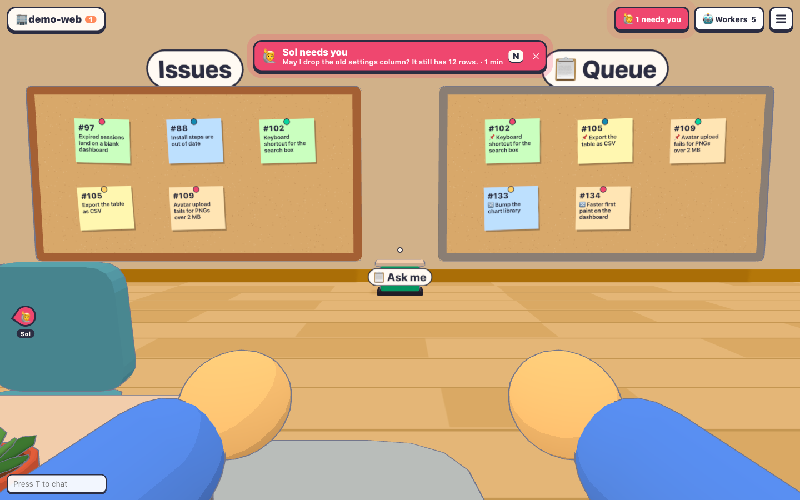
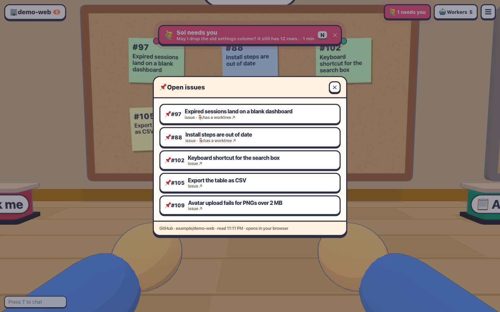
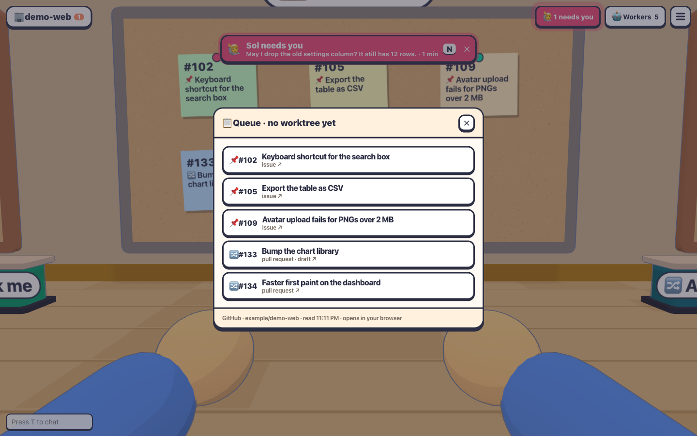
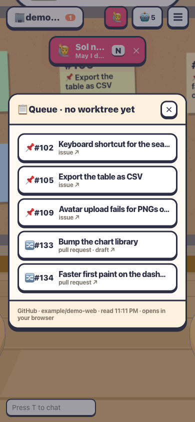

## Read-only LAN view (v2, #39)

A TV (LG webOS browser) or a phone on the LAN can watch the office, and do nothing else. **Off by
default**; it needs both variables, and the address must be one IPv4 address of this machine (no
`0.0.0.0`, no names):

```sh
ORCA_OFFICE_LAN_PORT=4318 ORCA_OFFICE_LAN_HOST=192.168.1.20 npm run start -w bridge   # then http://192.168.1.20:4318/
```

Turning it on opens a port to the LAN, a security change: decide it yourself; the launchd install
never sets it. Stub mode refuses LAN sockets.

What the LAN port is (`bridge/src/lan.ts`), enforced by the bridge, not by the page:

- **A separate HTTP server** on that address and port. It serves only the TV page (`/`, `/tv`) and its
  assets, and one WebSocket, `/lan`. `/client`, `/plugin`, `/health`, the page's token and the full
  office page are not there (404 / 403). `Host` must be the LAN address (421 otherwise), the socket's
  `Origin` the page's own; at most 16 LAN sockets.
- **Sends** only `lan.view` (on connect and whenever the building changes) and `pong`. `lanView` builds
  it field by field from an allowlist: floors (a project room is just "Project room": a Run's objective
  is private), badges (`waiting`, `busy`, `workers`), desk signs (Orca's worktree names; none in project
  rooms), figures with the office's made-up name, color, status, action (read/edit/test…), helper count,
  remote, bot name. **Never** a last message, a title, an activity line, a prompt, terminal text, chats,
  links' titles, task titles, gates, Run objectives or paths (design #20).
- **Takes** only `{ "t": "ping", "at": <number> }` (≤256 bytes, ≤120 a minute). Anything else (an action,
  typing, a chat, a floor change) closes the socket with 1008. No terminals, actions, chats or bots
  exist on that side at all.

The TV page (`client/tv.html`, `src/tv.ts`, 3.5 kB of script, no three.js) needs no pointer lock or
keyboard: big type, the repositories' floors first and then Staff and project rooms, each for 12 s;
tapping a floor holds it for a minute. A phone gets one column.

Tested on this machine only on `127.0.0.1:4418` (made-up data, `npm run dev:fake`): `/client` and
`/plugin` upgrades and foreign `Origin`/`Host` refused, `term.input` and `orca.create` close the socket,
no bubble text in the view. Not tried on a real TV.

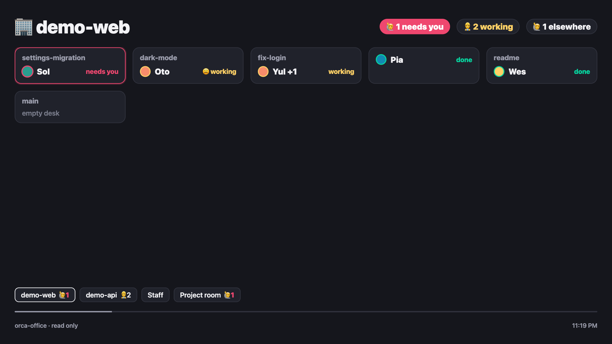
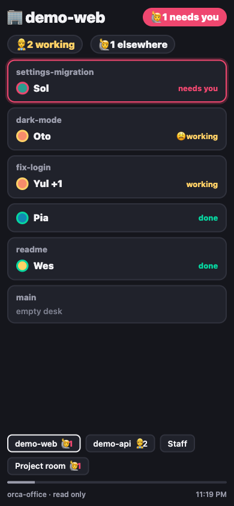

## Project rooms, decisions and deliveries (M4, #29, #30, #33, #34)

The bridge polls orchestration through the CLI, one call at a time (`bridge/src/live/runs-poller.ts`,
0.1–0.2 s each): every 10 s `run-list` and `inbox --limit 50`; a Run with open tasks or a pending gate
gets `run-show --full`, `task-list`, `gate-list --status pending` and `worker-list --run` every round,
a quiet one once a minute (and fully only when its `updated_at` moved). On this machine (3 finished
Runs) the first round is 13 calls / 2.5 s, later rounds 2 calls.

**Project room** (`FloorInfo.room = 'project'`, floor id `p-…`): one per *live* Run (open task or
pending gate, or changed in the last 2 h). The head of the table is the room's first desk; each task
with a worker gets a seat, signed with its status and worktree, and mirrors the figure at that desk
downstairs (same name, look and state; E/P/O/C reach the same agent). Fallback: a worktree **lineage**
(`parentWorktreeId` / `childWorktreeIds` from `orca worktree list`) that spans more than one repo or has
2+ children, while one of its worktrees is open or has an agent, and no Run covers it; the parent sits
at the head. The room's `waiting` counts pending gates too, so the elevator badge shows them.

**Who coordinates**: `coordinator_handle` was null in every real Run, so the bridge also learns it from
the mailbox: the sender (`orca_session_id:S`) of mail to one of the Run's dispatches. Seen on real
data: those senders are bot chats. A bot that coordinates a live Run sits at the head of its room and
its Staff office shows "🤖 Name → 🏗️ roof" until the Run is over (#33).
On the page (M5, #33) such a move is a walk, not a jump: a bot that leaves a floor (its Staff office,
or the room when the Run is over) hops off its chair, walks the way in backwards to the elevator and is
gone into it (`ElevatorExits`, client/src/features/workers/leaving.ts), and on the floor it comes to it
steps out of the elevator and walks to its seat (`Arrivals`). A bot is never "sent home" with a box.
Only one floor is drawn at a time, so the ride itself isn't shown; changing floors yourself seats
everyone at once as before. With neither, the head stays
empty under the sign "👑 Coordinator unknown".

| Bridge → page | What |
|---------------|------|
| `orca.project` | `{ floor, project }` on arriving and on change: `OrcaProject` (`source`, `objective`, `coordinator`, `tasks[]` with status, `gates[]` with `question`, `options`, the `seat` to open, `members` of a lineage) or null outside a room. |
| `gh.issues` / `gh.pulls` | In a room: the pending gates ("⚖️ …") and the open tasks as notes on its walls. |
| `orca.handoff` | `{ from, to, kind, subject }`: a seat to seat delivery on the page's floor; `null` is the roof. |

**Deliveries** (#34): new mail since the last read (`ask`, `reply`, `worker_done`, `escalation`; not
`status`) and new rows in `worker-list` (a dispatch) fly as an envelope with a tag (`subject` cut to 60):
in the room between the worker's seat and the head, and on the worker's own floor from its desk up to
the roof or down from it. What is in the mailbox when the bridge starts is not news.

Privacy (design #20): objectives, task titles, gate questions/options and subjects are cut with
`toBubble` to 60 the moment they are read; message bodies are never read. Nothing is logged or stored.
The office only reads: gates are decided in Orca ("Open in Orca" opens the desk the gate blocks).

## Talking to bots (M5, #37)

A bot's figure (Staff floor, or the head of a project room) carries `orca: { terminal: false, remote:
false, bot: '<name>' }`; its desk hint offers **E Chat**, which opens the bot panel. Route and the
real-Orca check: [m5-bots.md](m5-bots.md). Bridge: `bridge/src/live/bots.ts`.

| Page → bridge | What |
|---------------|------|
| `orca.bot.open` | `{ workerId }`: the bot's chats; `orca bot chats --bot <name>` now and every 10 s while open. |
| `orca.bot.chat` | `{ workerId, chatId }`: show one (an open chat of that bot): `orca agent read <chatId>` every 3 s. |
| `orca.bot.send` | `{ workerId, reqId, chatId, text }`: write to the bot in `chatId`, or `'new'` for a new chat. |
| `orca.bot.close` | `{ workerId }`. |

| Bridge → page | What |
|---------------|------|
| `orca.bot` | `{ workerId, bot, chats[] }`: `OrcaBotChat` (`id`, `title` cut to 60, `home`, `lastActivityAt`), Home first, then newest; closed chats left out. |
| `orca.chat` | As for chat agents, plus `chatId`. A user turn that is Orca mail has its header taken off and `mail` (`{ office: true }` for the office's own messages, else the sender's name). |
| `orca.bot.sent` | `{ workerId, reqId, phase: 'sending' \| 'sent' \| 'failed', chatId?, error? }`; a new chat's id comes with `sent` once it turns up in the bot's list. |

Sending: `orca orchestration send --from orca-office --to bot:<name> --chat <id|new> --type handoff
--subject=<first line, 60> --body-file - --json`, the text on stdin. Checked first: the page has that
bot open, the bot is in `orca bot list` and not paused, the chat is one of its open chats read again
right before sending (or `new`), 1–8000 characters without NUL; 1 message per 5 s and 200 per hour for
the whole bridge. The page shows *Sending… → Sent → <bot> is working… → <bot> answered* from the
chat's next reads (`state: working`, then a new answer). Message text and answers are never logged,
stored, or put in tests or screenshots; the fake CLI (`npm run dev:fake`) answers made-up messages
after ~7 s.

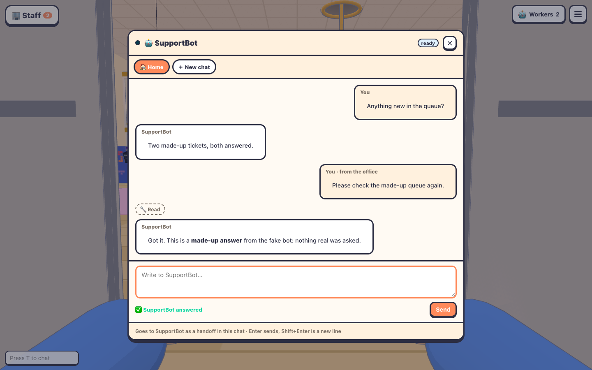
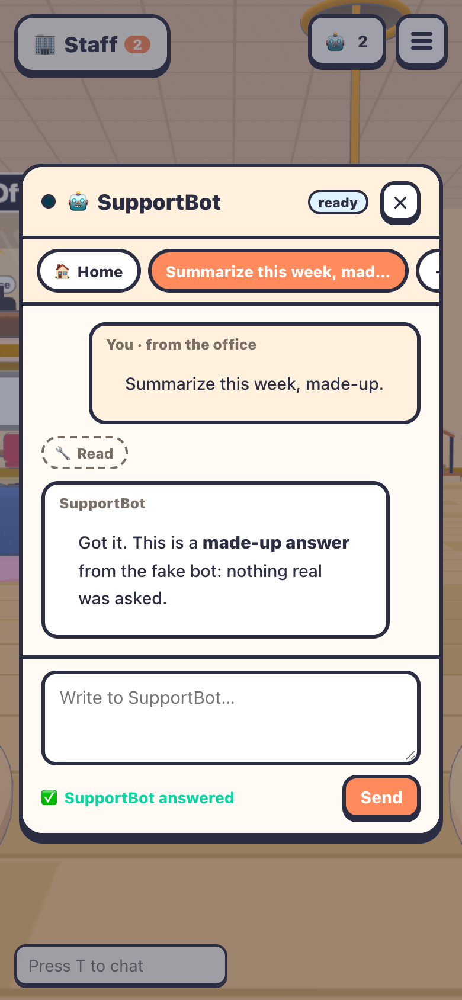

## Services board (M6, roadmap B7)

The 🌐 Services board on each repository's floor lists the dev servers running in that repository's
worktrees; a desk whose worktree runs one shows `🖥 :5173` on its sign. Bridge:
`bridge/src/live/ports.ts`.

- `orca ports --all --json` every ~10 s while a page is open (`execFile`, no shell). A row is kept
  when Orca tied it to a worktree (`kind: workspace`) and it looks like something to open: HTTP, an
  address the server printed in an Orca terminal, or a port below 49152 (agents' MCP sockets and
  other ephemeral listeners live above). The office's own ports are left out.
- Listeners Orca tied to no worktree (`kind: external`: Orca, Obsidian, system services, agents'
  sockets) are left out entirely rather than shown as "Other on this Mac": they are not the
  office's business and would leak what else runs on the Mac.
- The command line comes from `ps -o command= -p <pid>` once per process: the program's name
  instead of its path, paths cut to their last part, and every value that may be a secret replaced
  by `…` (`--token=…`, `KEY=…`, the value after `--password`, anything that looks like a token);
  80 characters at most. The page title is a GET of `http://127.0.0.1:<port>/` (1.5 s, 64 kB, once
  a minute per server), cut to 60. Never the environment; nothing is logged or stored.
- `FloorView.services` / `{ t: 'services', state: { items } }`: `ServiceInfo` with `port`,
  `command`, `worktree`, `branch`, `deskId` (its desk on this floor, if Orca has it open), `url`
  (the printed local address, else `http://localhost:<port>`), `title`, `since`. Open ↗ opens the
  URL in a new tab; the office runs on the same Mac, so there are no tunnels (agent-office's SSH
  tunnels, Tailscale links and deploy hints are gone).
- `npm run dev:fake` serves three made-up servers (fake `ps` in `ORCA_OFFICE_PS`).

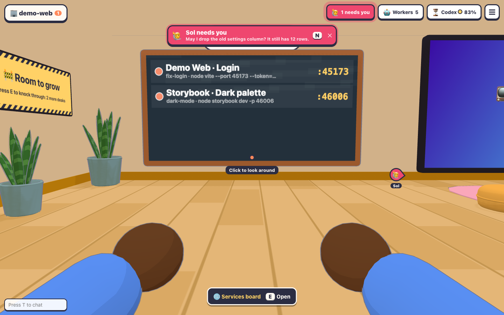
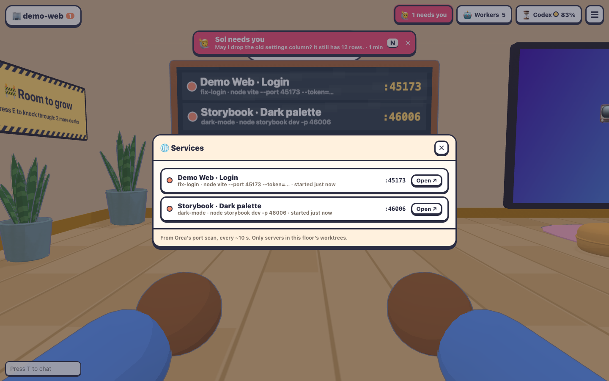
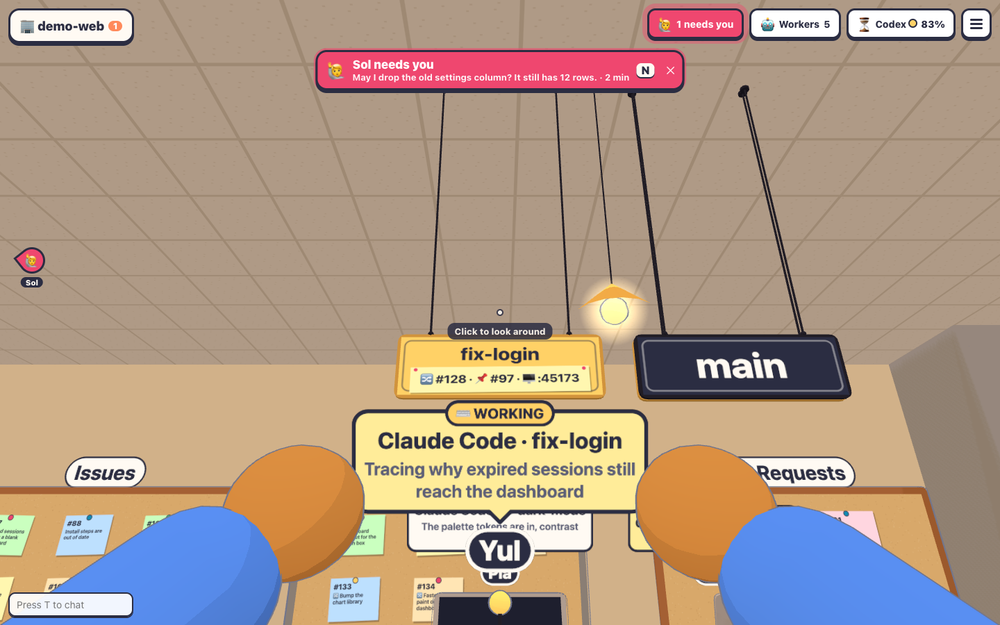
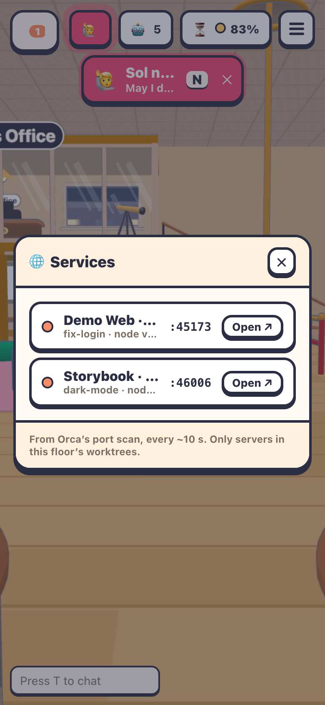

## Needs you, for the whole building (M6, roadmap A1–A4)

`{ t: 'orca.waiting', items: OrcaWaiting[] }` comes after `welcome` and whenever it changes:
every agent asking on any floor (a project room's mirrored figures only once) and every open
decision gate, longest first. An item has `key` (the figure's id or `gate:<id>`), `kind`, `floor`,
`floorName`, `workerId`, `deskId`, `name` (worktree or bot; "Decision" for a gate), `ask` (already a
bubble) and `since` (a gate's: when the bridge first saw it; Orca gives no time).

- The pill and the dock button say "🙋 2 need you · 1 here, 1 on blog-ai", plus this floor's done
  ones nobody looked at. The banner shows the longest waiting anywhere, with "on <floor>" when it is
  elsewhere. N goes through them all in that order and takes the floor list to another floor first;
  a gate takes you to the desk its board names (`client/src/waiting-all.ts`).
- Tab title "(2) …" and a red count on the favicon. A desktop notification (and the alarm) for
  someone who starts waiting on another floor, or a new gate; clicking it takes you there.
- Orca's status bar (A4): the bridge sends the plugin `{ type: 'status', waiting, names }` (worktree
  names only, never what they ask) when the count changes and on connect; the plugin's existing
  "Office" item becomes `Office 🔴 2` with the names in its tooltip. No new capability.

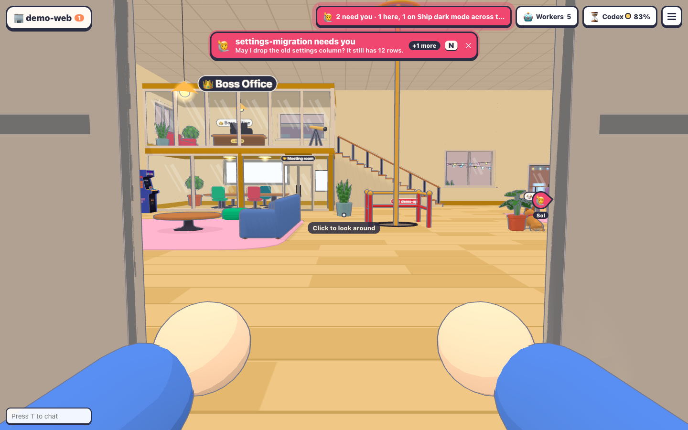
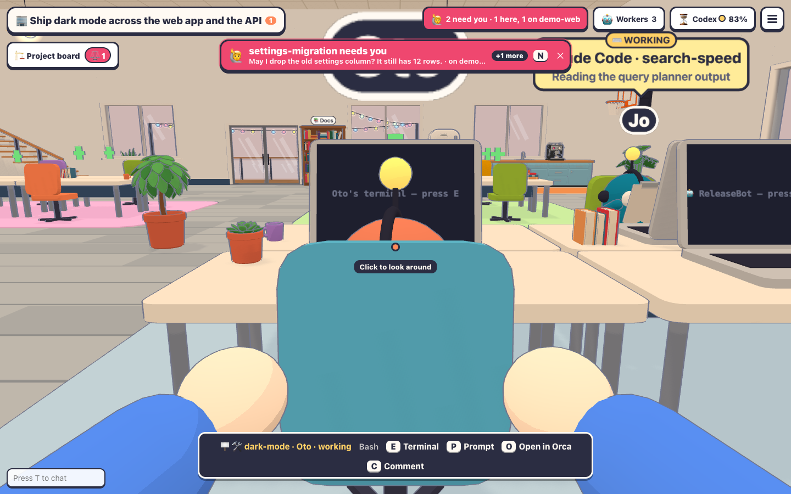

## Names, the roster and ⌘K (M6, roadmap A5–A7)

- A figure is named after its worktree (`fix-login`; a second agent at the desk `fix-login · 2`),
  no longer a made-up name; `WorkerInfo.orca` carries `worktree` and `branch`. The Workers panel,
  the terminal's header (with `🙋 <question>` while it asks) and ⌘K show the branch.
- `{ t: 'orca.roster', floors: OrcaRosterFloor[] }` after `welcome` and on change: every floor's
  figures (repository floors and Staff; project rooms only mirror them) with name, status, desk,
  branch and bubble. The Workers panel lists the other floors under this one's, grouped; ⌘K finds
  them too. Either takes you there by the floor list.
- In a project room ⌘K lists its tasks and decisions as such, and its wall notes carry no "#1".
- L at an Orca desk with links opens them, as its hint says (it used to do nothing).

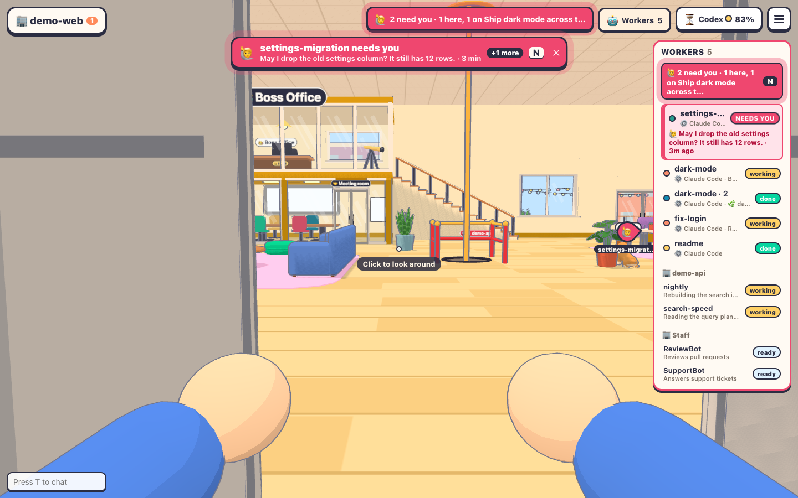
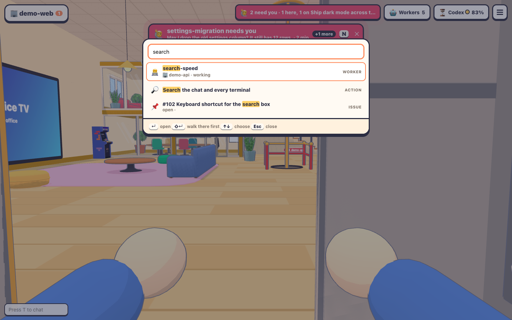
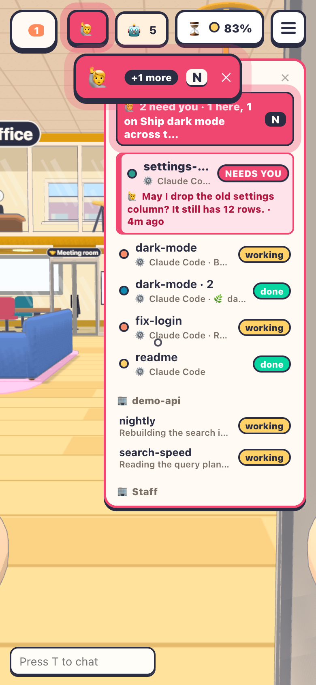

## Stale data, the overview, the map and the help (M6, roadmap A8–A10)

- **Stale (A8)**: while the bridge is unreachable or Orca's plugin is gone, the world turns grey,
  the needs-you signals dim and the notice says `· last update 2 min ago`, so an old "working" or
  "needs you" doesn't pass for a live one.
- **Overview (A9)**: the office opens with the camera high over the south wall looking down at both
  rows of desks, not at the lobby. A step, a jump or a click puts you back in your own eyes; **V**
  goes up again. **M** opens the floor's map: every desk from straight above in its state's colour,
  and a list of the desks with an agent or a sign; a click (or Enter) takes you to that desk.
- **Help (A10)**: seven rows for looking after the agents (N, ⌘K, E, O, R, M, V), everything else
  folded under "All controls" (the agent-office keys that do nothing on Orca are gone). The first
  time the office opens on a computer, one line says "Press N … M … H"; closing it or pressing N
  puts it away for good (this browser).

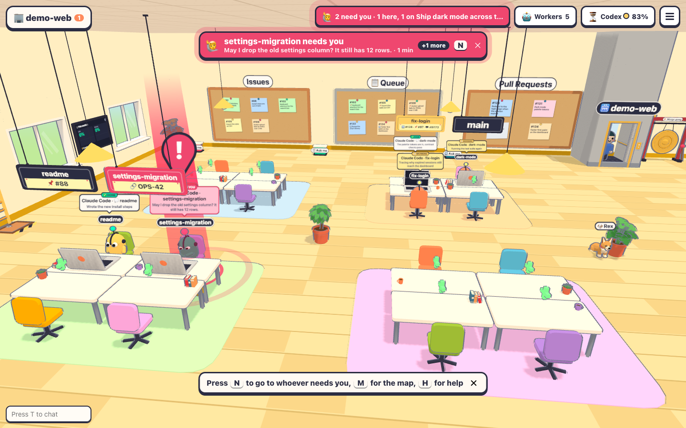
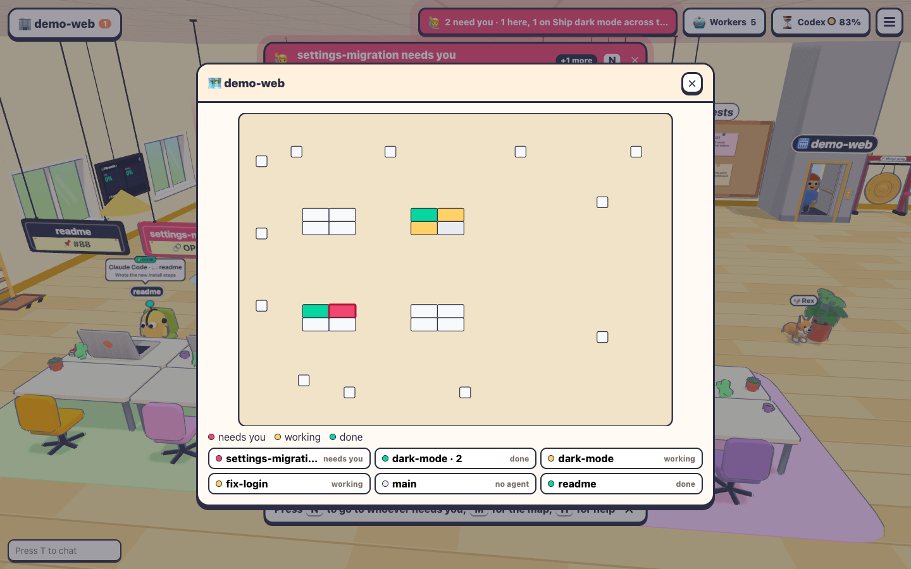
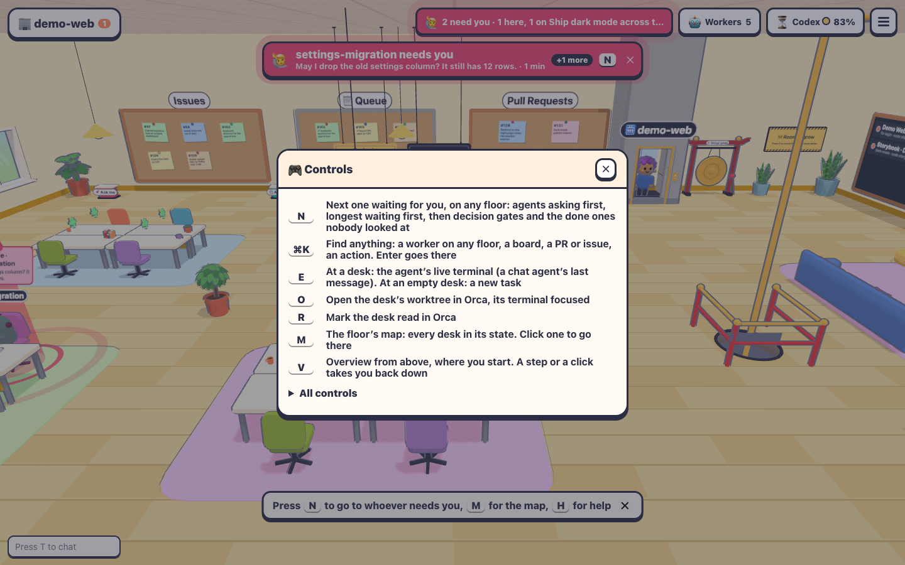
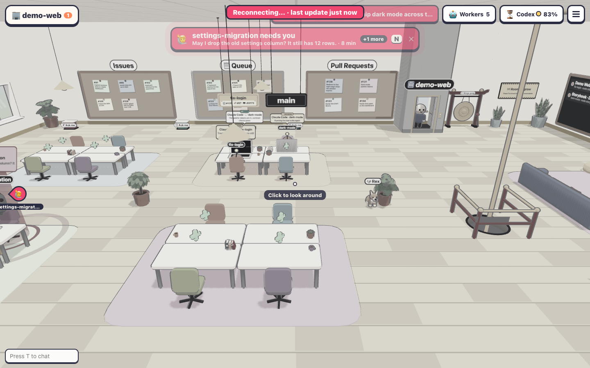

## Fun, the phone, motion and the keyboard (M6, roadmap A11–A14)

- **Fun (A11)**, ⚙️ Settings → Fun, off by default (`client/src/fun.ts`): the chat box, emotes,
  hanging pictures, the arcade cabinet, the gong, the hoop and the rooftop bar (darts, axes, DJ).
  Off, their props stay where they are but do nothing (an invisible prop would still be bumped
  into), and they're gone from the ☰ menu, ⌘K, the help and the keys (T, Enter, G, 1–6, F, Q).
  The dog stays.
- **The phone (A12)**: a touch screen up to 900 px wide, or any window under 520 px, opens
  `live.html` instead of the 3D office (`?3d=1` keeps the 3D one). It is the office as a list on
  the same `/client` socket: *Needs you* (agents and decision gates from `orca.waiting`), *Working*
  and *Done* (`orca.roster`), each with **Reply** (a line typed into a terminal agent, as P does)
  and **Open in Orca**. The old `live.html`, which showed the plugin's raw messages, and its
  `?list=1` path in the bridge are gone.
- **Reduced motion (A13)**: with the system asking for less motion there's no confetti, dancing,
  finishing spin or DJ strobe; the loader no longer waits for the dog.
- **Keyboard (A14)**: Tab moves the focus through the top bar, the banner and windows (with a
  visible ring), Enter or Space presses the button in focus; the ☰ menu moved to **`**. A project
  room's gate answers are plain text now ("Options: Yes · No"), not pills that looked like buttons
  and did nothing; deciding stays in Orca (its "Open in Orca" button works).

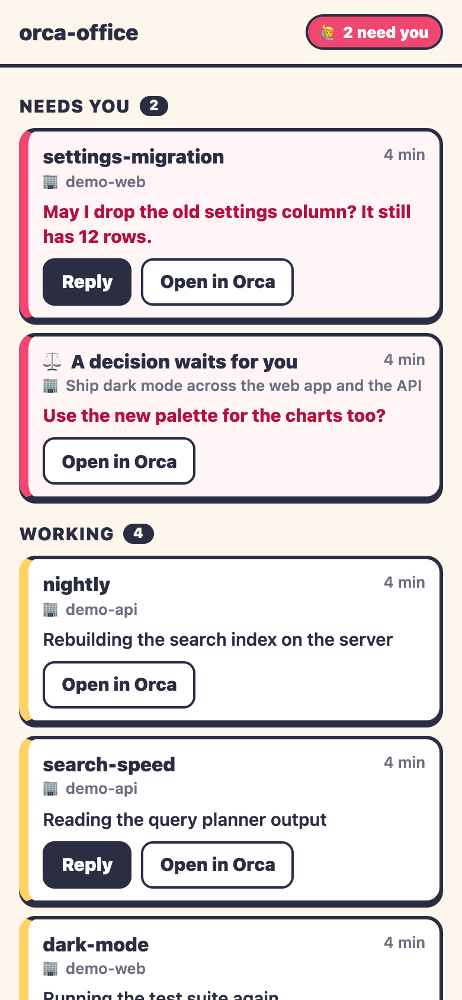
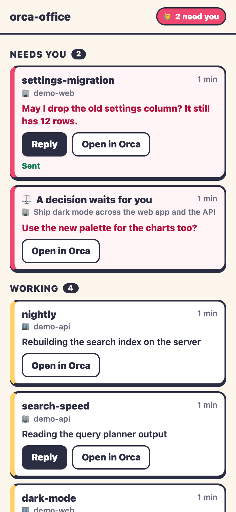
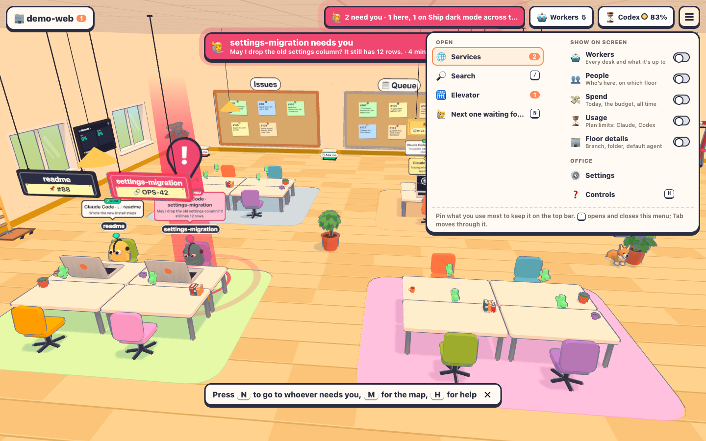
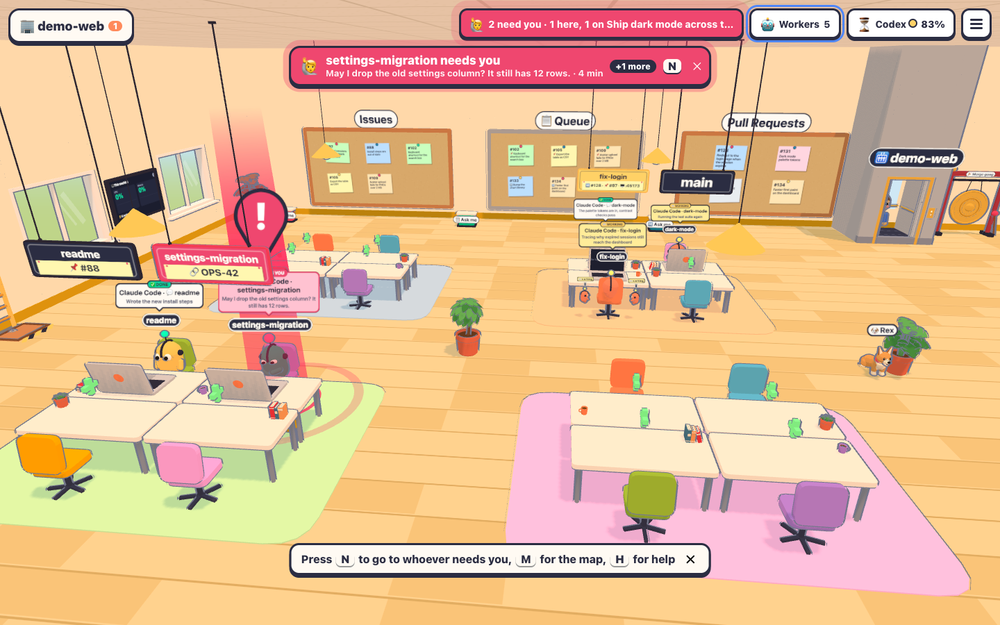
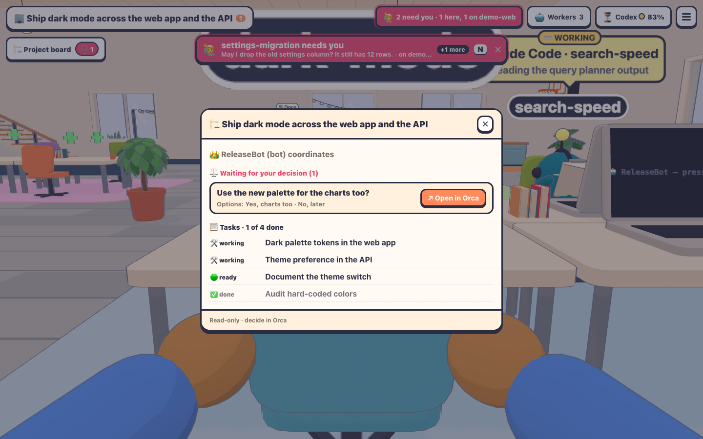

## Answering from the banner, and "stuck?" (M7, roadmap B1, B5)

**B1, answering without the terminal.** The needs-you banner (and the phone's list) answers whoever has
waited longest:

- A terminal agent Orca shows **`blocked`** is on a permission prompt (`OrcaWorkerInfo.asks` /
  `OrcaWaiting.asks = 'permission'`): **✓ Yes · ✓✓ Always · ✕ No**. The page sends only
  `{ t: 'orca.answer', workerId, choice: 'yes' | 'always' | 'no' }`; never a key. The bridge
  (`bridge/src/live/permission.ts`) checks the agent is a terminal agent on this machine that Orca
  shows blocked or waiting, reads the last 30 lines of its terminal (`terminal.read`), finds the last
  numbered menu with a "Yes…" and a "No…" option, and sends the one key that picks the answer through
  the usual typing path (`orca terminal send --text=`): the option's own shortcut when it has one
  (Codex: `y`, `a`; a trailing `(esc)` is Escape), else its digit (Claude Code takes `1`/`2` at once,
  no Enter). "Always" is the Yes option that says *don't ask again* / *always* / *for this session*.
  No menu on the screen: `no_prompt`, nothing is typed; no such option: `no_option`.
  The page also sends the wait it showed (`since`); a prompt that came up after it (Orca's state
  changed since) is refused with `prompt_changed`, so a click never approves a prompt the page didn't
  show.
- A terminal agent Orca shows **`waiting`** asks a question: a one-line box, Enter sends it as a
  prompt (`worker.prompt`, text then Enter).
- A chat agent (no terminal): **↗ Open in Orca**. A decision gate, or an agent on another host: N
  takes you there, as before.

The same rate limit as other actions (20, then 2 a second per page); the screen text is used for that
one decision and dropped. Tested on made-up screens shaped like Claude Code's and Codex's prompts
(`permission.test.ts`) and on the fake stack (`npm run dev:fake`: `settings-migration` is on a made-up
Claude Code prompt; Always typed `2` into it). Not tried on a real agent's prompt.

**B5, "stuck?".** Orca keeps an agent that hangs "working". The bridge notes when Orca last said
anything about each agent (`quietSince`: a status event, a tool hook, a newer `updatedAt` or a new
last message in `orca agent list`) and sends it with working figures and in the roster
(`OrcaRosterWorker.quietSince`, `workingSince`). The page decides (`shared/src/office/stuck.ts`):
working and quiet for **15 min**, or working for **4 h** at a stretch, by default; ⚙️ Settings →
*Stuck? after quiet for* / *after working for* changes both (this browser). Such a figure dozes off at
its desk (sways, no typing, grey light, a grey **😴 STUCK?** card); the Workers panel and the phone's
list show it under **😴 Maybe stuck**, apart from the ones that really need you. It's only a guess:
nothing is sent to it.

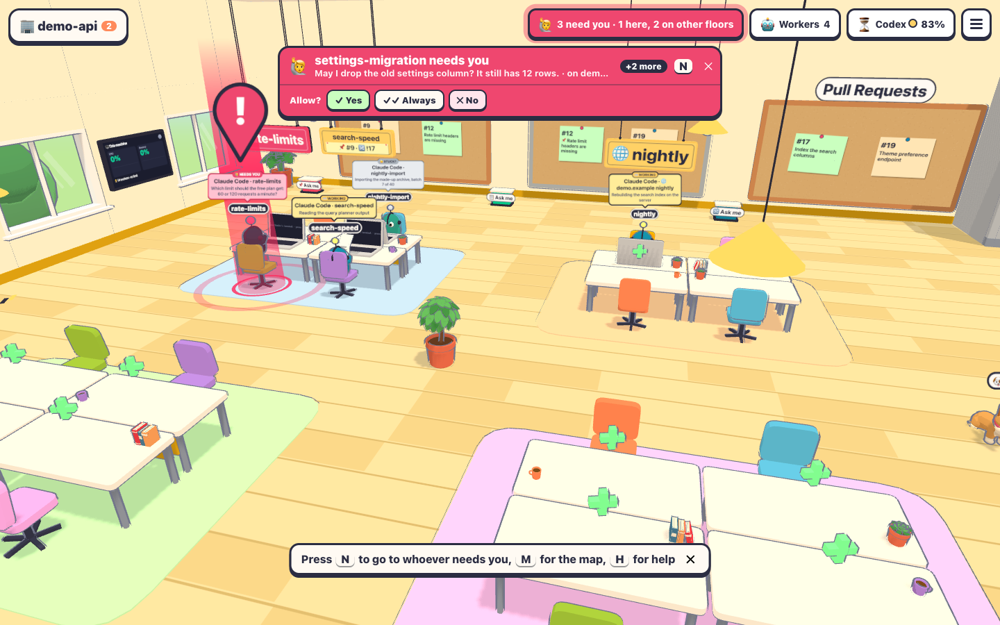
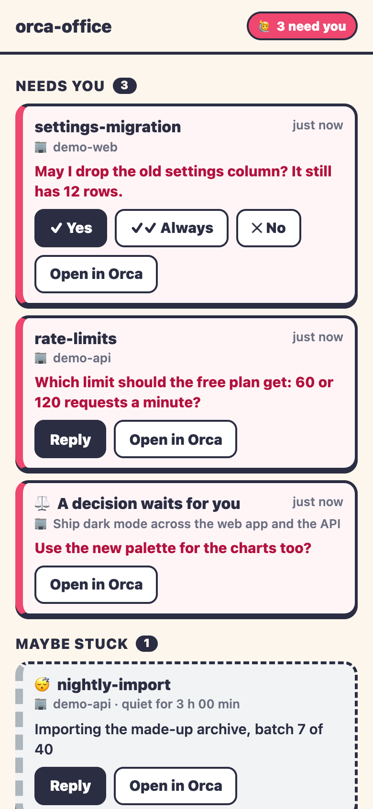
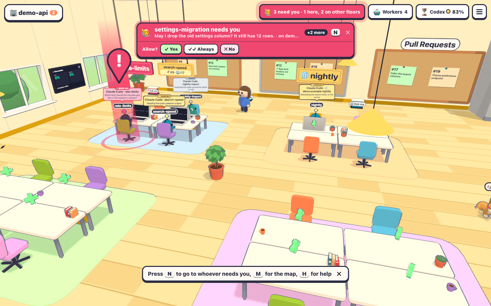

## Command Center and Orca's Kanban status (M7, roadmap B3, B10)

**B3.** **G** (or ☰ → Command Center) puts the whole building on one screen, from the roster and the
waiting list the page already has (no new bridge calls): **🙋 Needs you** (agents asking, and decision
gates), **⌨️ Working**, **😴 Stuck?** (B5's rule), **✅ Done** (done and unread in Orca) and **💤 Ended**
(done and read, idle bots). A card shows the worktree, branch, floor, Kanban status, how long it has
been so and its bubble. A click goes to its desk (by the floor list if it's on another floor), Enter
or ⏎ goes there with its terminal (a chat agent: its conversation) open, ↗ Orca opens it in Orca, and
an agent that asks is answered on the card as in the banner (B1: Yes / Always / No, or a line).
With the fun on, G stays the emote wheel and the Command Center is in the ☰ menu. On a phone it is a
row of columns you swipe through (the phone's list stays the default view there).

**B10.** `orca worktree list --json` carries each worktree's `workspaceStatus` (Kanban; seen on Orca
1.4.274: `in-progress`). The bridge passes a short lowercase id only (`cleanKanban`), on the desk's
sign (`DeskLabel.kanban`: a coloured band across the top, e.g. IN PROGRESS yellow, IN REVIEW purple,
DONE green, unknown ones blue), on figures (`OrcaWorkerInfo.kanban`) and in the roster. The Command
Center filters by it (Orca status chips) and the phone's list shows it (`📋 In progress`).

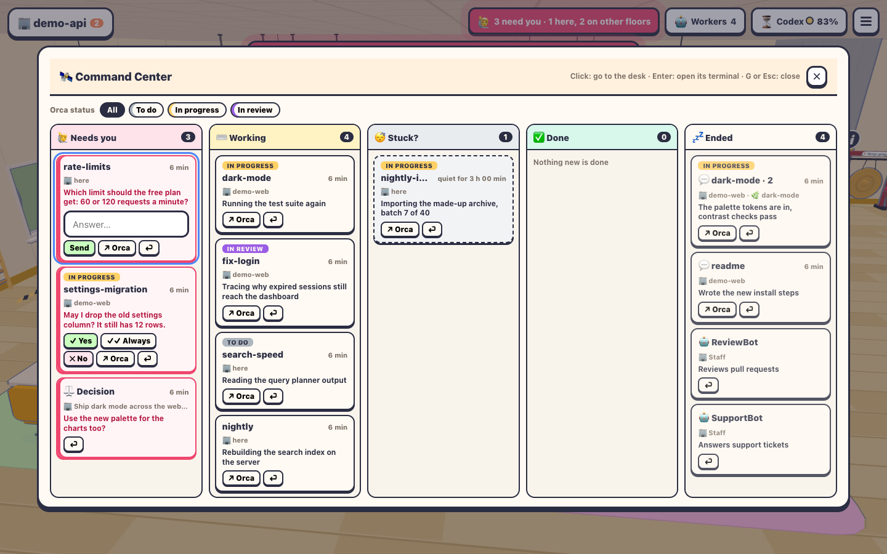
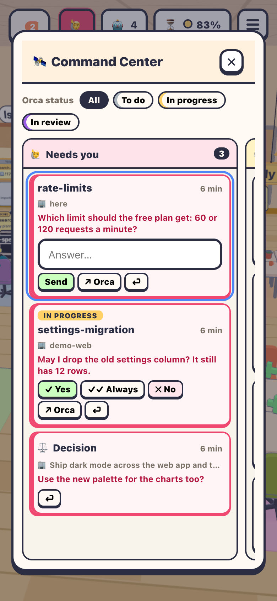
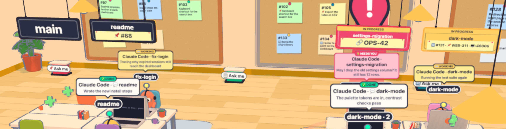

## Signals and steering (M7, roadmap B2, B13)

**B2, a signal for each.** A figure that needs you says why: **🔐 MAY I?** (Orca `blocked`, a permission
prompt) or **❓ QUESTION** (`waiting`), and one whose last turn failed (the plugin's
`agent.status.changed` carries `mainAgent.outcome: 'failure'`; `OrcaWorkerInfo.failed` until it works
again) shows a red **❌ FAILED** with a red light instead of done. Each has its own sound: a permission
rings the alarm, a question three rising notes, done the two-note ding, a failure a low falling buzz.
⚙️ Settings → *Say it out loud* (off by default) has the browser's own voice (Web Speech API) say
"blog-ai is waiting for permission" / "… has a question" / "… is done" / "… failed": the worktree's
name only, never what the agent asks; nothing leaves the browser. Repeated failing tests while working
were already acted out (`failing`, #16).

**B13, steering, only on a click.** `{ t: 'orca.steer', workerId, steer }` for a terminal agent on this
machine: `interrupt` sends Esc (only while it's working), `summarize` and `continue` type the office's
own short prompts (`ORCA_STEER_PROMPTS`) with Enter; the page never sends text here (P is for that).
The terminal's header has 📝 Summarize and ▶ Continue (⎋ Esc interrupts, as before); a Command Center
card has ⏸ / 📝 while it works and ▶ / 📝 once it's done. **Resume:** E at an empty desk whose
worktree Orca has open offers *↻ Resume last session* in the New task window:
`{ t: 'orca.resume', deskId }` → the plugin's `agent.listSessions` for that workspace, its newest
session no terminal runs (claude, codex, opencode, pi, copilot, cursor), then `agent.resume`, which
starts it in a new terminal there. Both calls are new on the plugin's allowlist (with exact params);
they need `agent:launch`, which it already has, so no new capability. Session titles never leave the
bridge.

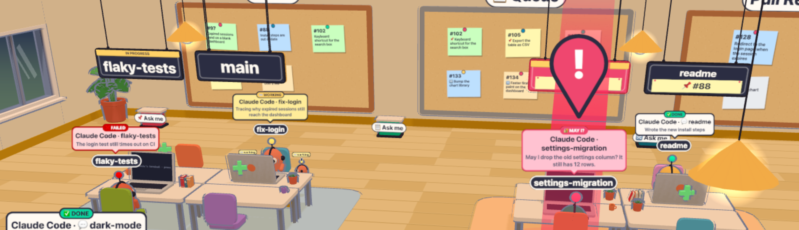
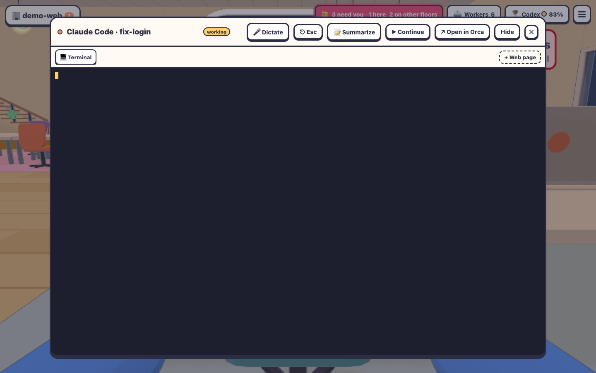

## Review queue (M7, roadmap B4)

A done agent whose worktree has a pull/merge request in Orca (`linkedItems`, #32) waits on a review.
The repo board's `gh pr list` (#38) now also asks for `additions,deletions,statusCheckRollup`: still
one call per repository, kept 3 min, so the checks cost nothing extra. Only the checks' states are
read (`ciOf`: any failure → `failing`, anything running → `pending`, all passed or skipped →
`passing`, none → `none`); their names, links and output are dropped. `glab mr list` gives a head
pipeline's status where it has one. `OrcaForgeItem` carries `ci`, `additions`, `deletions`.

On the floor: the top bar shows **👀 2 to review** while anyone waits, which opens the **Review queue**
(also in ☰): longest waiting first, each with `🔀 #131`, the worktree, the title, ✅ / ❌ / ⏳ checks,
`+318 −96` and how long it has waited; **↗ Open the PR** (https, a new tab) or **Go to its desk**. The
figure wears its PR on its card (🔀 PR #131 OPEN, green) instead of DONE. A merged or closed one drops
off with the board's next read. Without `gh` (or not logged in) the queue still lists what Orca links,
with the checks unknown. Figures don't walk to a review desk: the queue is a list (see the M7 issue).

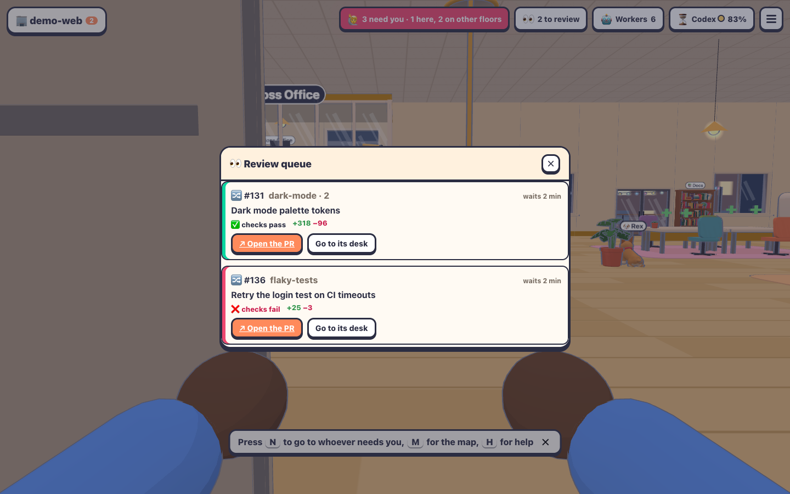
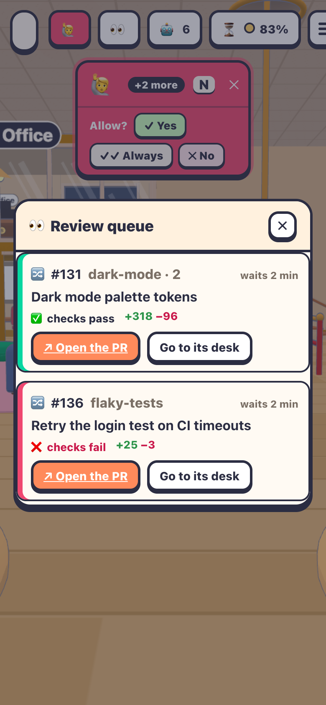
